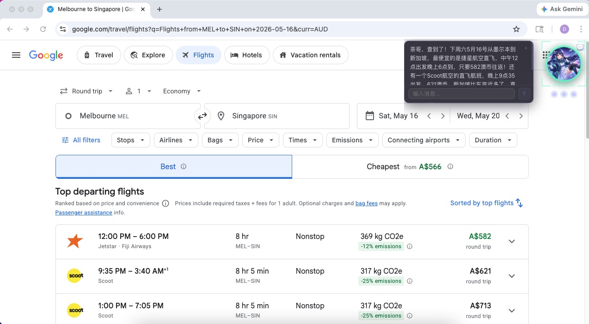

# Pocket Agent

> A minimal desktop AI voice companion that lives on your screen — press a key, speak, get things done.
>
> **v0.3.0** — see [releases/0.3.0.md](releases/0.3.0.md) for changelog

Pocket Agent is a compact desktop widget built with **Tauri 2 + Svelte 5 + Rust**. It connects to a local [Hermes](https://github.com/nousresearch/hermes) agent gateway via SSE streaming for real-time voice conversations with an LLM. Think of it as a desktop pet that actually helps.

> **Platform status:** PA runs on **macOS only**; Windows is not developed yet. The only supported backend is **Hermes** (OpenClaw is no longer supported). The **Android phone terminal is experimental**: there is no store release, so you build the APK yourself and install it over `adb`, which needs **Developer options → USB debugging** turned on on the phone (see [android/README.md](android/README.md)).

---

## On-demand computer interaction

Install Hermes and Pocket Agent on each Mac, then enable the Hermes API computer tool and grant CuaDriver permissions. Requests go straight to Hermes, which decides from the prompt whether to use `computer_use`: search, lookup, and app-operation requests use the visible local browser or app by default, while an explicit request for results only keeps the desktop untouched. Ordinary conversation and knowledge explanations do not open apps. Text and voice requests can inspect a window, perform an authorized action, and read it again to check the result. The main model may be text-only; Hermes can use auxiliary vision when pixels are needed. See the [Mac installation and troubleshooting guide](docs/computer-interaction.md). The chat panel includes **▣** to inspect and **ⓘ** to check setup; no continuous screen monitoring is enabled.

## How It Works

```
+---------------------------------------------------------------+
|                          Pocket Agent                         |
|  +----------+  +----------+  +---------------------------+    |
|  |  Avatar  |  |  Chat    |  |  Dynamic Island           |    |
|  |  Widget  |  |  Panel   |  |  (recording indicator)    |    |
|  +----------+  +----------+  +---------------------------+    |
|       |             |                                         |
|  Svelte 5      Svelte 5                                       |
|  (frontend)    (frontend)                                     |
|       |             |                                         |
|  +----+-------------+--------------------------------------+  |
|  |                    Tauri Bridge                         |  |
|  |               (invoke / events / state)                 |  |
|  +----+-------------+--------------------------------------+  |
|       |             |                                         |
|  +----+------+  +---+-----------+  +-----------------------+  |
|  |  Voice    |  |    Chat       |  |  API server :8650     |  |
|  |  Pipeline |  |    Engine     |  |                       |  |
|  |           |  |               |  |  /push  /bridge/send  |  |
|  | - hotkey  |  | - SSE stream  |  |  /ui  /ui/ws  /audio  |  |
|  | - record  |  | - TTS play    |  |  /mcp (tools for      |  |
|  | - STT     |  | - lang detect |  |        Hermes)        |  |
|  +----+------+  +---+-----------+  +---+---------------+---+  |
+-------+-------------+------------------+---------------+------+
        |             |                  ^               ^
   WAV audio     HTTP/SSE       MCP tools (camera,   WS /ui/ws
        |             |         switch_device)       + /audio
        v             v                  |               |
  +-----+--------+  +-+------------------+-+  +----------+-------+
  | Voice service|  | Hermes gateway       |  | Android phone    |
  | :8651 (local)|  | :8642                |  | (same LAN)       |
  | Whisper + VAD|  +----------------------+  | screen, mic,     |
  | speaker + KWS|                            | speaker, camera  |
  +--------------+                            +------------------+
```

### Voice Pipeline

1. **Press hotkey** (default: `RightShift`) — macOS CGEventTap captures the global hotkey
2. **Recording starts** — pre-warmed cpal Stream Daemon activates instantly (~11ms latency)
3. **Press hotkey again** — recording stops, WAV saved to temp file
4. **STT** — faster-whisper transcribes locally (auto language detection, configurable model via `STT_MODEL`)
5. **Send to backend** — text + voice hint streamed to the Hermes gateway (:8642). A local Hermes gateway with `API_AGENT` empty and desktop integration available uses `/v1/runs` (tool progress, approvals, a real stop command); everything else uses `/v1/chat/completions`
6. **TTS playback** — edge-tts generates audio, rodio plays it via system speakers

Press **Escape** during recording to cancel. Minimum recording: 1.5s. Maximum: 30s (auto-cutoff).

### Resident Voice Service

Steps 4 and onward do not spawn a fresh Python process per utterance. Pocket Agent starts a
**resident voice service on `127.0.0.1:8651`** (`src-tauri/resources/stt-server.py`, FastAPI)
that keeps Whisper, Silero VAD, the speaker model and the KWS model loaded:

| Endpoint | Purpose |
|---|---|
| `POST /transcribe` | Whisper transcription (VAD short-circuits silent audio to avoid hallucination) |
| `POST /vad`, `POST /vad/check` | Silero VAD — speech present? used by the barge-in confirmation gate |
| `POST /speaker/embed`, `/speaker/enroll`, `/speaker/train` | voiceprint enrollment and matching |
| `GET /kws/status`, `POST /kws/install`, `/kws/session`, `/kws/audio/{sid}`, `/kws/check` | sherpa-onnx keyword spotting for the wake word |
| `GET /health` | liveness |

If the HTTP path fails, transcription falls back to a one-shot subprocess, so dictation keeps
working (slower, and without the VAD short-circuit).

`/speaker/*` and `/kws/*` are protected: they require a bearer token written to
`~/.pocket-agent/server.token` at service startup **and** an `Origin` from the Tauri webview,
so a page in your browser cannot drive them.

### Hands-Free Path

With the wake word enabled there is a second entry point that needs no keypress:

```
always-on mic → sherpa-onnx KWS (wake phrase)
              → [optional] speaker verification (owner-only)
              → conversation turn loop (silence timeout ends each turn)
              → barge-in: sustained RMS + Silero VAD confirmation interrupts TTS
```

---

## Features

- **Voice-first interaction** — push-to-talk with local Whisper STT, no cloud dependency for speech recognition
- **Real-time streaming** — SSE streaming from LLM with live text display
- **Tool status and reasoning panels** — tool steps (with Hermes' own preview, e.g. the terminal command) under the avatar row; the model's reasoning below them when **Show reasoning** is on (needs the local Hermes patch on `/v1/runs`, see [HERMES.md](HERMES.md))
- **TTS voice response** — edge-tts with automatic language detection (Chinese, English, Japanese, Korean + more)
- **Session memory** — daily auto-rotating sessions with compressed context summaries
- **Language tracking** — auto-detects user language per message, follows user's language seamlessly
- **Multi-language voice** — configure primary + auxiliary TTS voices, auto-switch based on detected language
- **Configurable hotkey** — capture any key via Settings, no restart required
- **Local + SSH hotkey parity** — fn/globe and modifier hotkeys behave consistently whether PA is launched locally or from an SSH session
- **Wake word (hands-free)** — always-on sherpa-onnx keyword spotting, optionally gated by speaker verification so only your voice triggers it
- **Continuous conversation** — turn loop with silence-based turn ending; no keypress per utterance
- **Barge-in** — talk over the assistant to interrupt it; a Silero VAD confirmation gate rejects non-speech noise
- **Resident voice service** — Whisper / VAD / speaker / KWS models stay loaded on `:8651`, with a subprocess fallback if it is unreachable
- **On-demand desktop interaction** — Hermes decides per request whether to act in your visible browser/app via `computer_use`, retrieve in the background, or just talk
- **Settings center** — SQLite-backed settings UI in its own window
- **Interruptible TTS** — pressing the hotkey while PA is speaking stops current audio immediately before recording starts
- **TTS toggle** — disable voice output for text-only mode
- **Animated mesh avatar** — the widget circle shows a 2D mesh avatar (xingyin) that blinks and idles, reacts to listening / thinking / speaking, and follows the reply emotion; falls back to the image or CSS avatar if it can't load (see [docs/mesh-avatar.md](docs/mesh-avatar.md))
- **Compact widget** — 220x360px always-on-top window, dark sci-fi aesthetic
- **Phone terminal (experimental)** — an Android phone on the same LAN can be PA's screen, microphone and speaker (`android/`); the desktop window hides while the phone drives. Hermes can open, flip and read the phone camera and move PA between the phone and the Mac by voice (`switch_device`), through PA's own MCP server. The APK is built and installed over `adb` with USB debugging on (see [android/README.md](android/README.md))
- **macOS native** (macOS only; no Windows build yet) — global hotkey via CGEventTap, CoreAudio recording, menu bar tray

---

### API

Pocket Agent runs a local HTTP server on port `8650`.

- **POST /push** — push message for TTS playback
- **POST /bridge/send** — bridge third-party apps to Hermes
- **GET /health** — health check
- **GET /ui/, WS /ui/ws, WS /audio** — phone terminal (PA's frontend, commands / events, and mic / speaker audio)
- **POST /mcp** — MCP server for Hermes: `phone_camera_open` / `phone_camera_snapshot` / `phone_camera_close` / `switch_device`

See [docs/API_MANUAL.md](docs/API_MANUAL.md) for full API details.

---

## Tech Stack

**Frontend (Svelte 5)**
- Svelte 5 with runes (`$state`, `$derived`, `$effect`, `$props()`) + TypeScript
- Vite 6
- [mesh-avatar-element](https://github.com/shinshin86/mesh-avatar-studio) (WebGL2) for the animated avatar

**Desktop (Tauri 2 / Rust)**
- Tokio + reqwest + eventsource-stream
- cpal + hound (recording), rodio (playback)
- CGEventTap (macOS FFI) for global hotkey

**AI / Voice**
- [Hermes Agent](https://github.com/nousresearch/hermes) gateway (default `http://localhost:8642`)
- [faster-whisper](https://github.com/SYSTRAN/faster-whisper) for local speech-to-text
- [edge-tts](https://github.com/rany2/edge-tts) for text-to-speech
- Any OpenAI-compatible LLM configured in Hermes (tested with GLM-5)

---

## Backend Compatibility

| Backend | Status | Notes |
|---------|--------|-------|
| **Hermes Agent** | Supported | The only supported backend |
| **OpenClaw** | Not supported | Support has been dropped |

Pocket Agent talks to Hermes over its OpenAI-compatible API (`/v1/runs`, falling back to `/v1/chat/completions`) with SSE streaming. Other gateways are not supported.

---

## Privacy and Security

Pocket Agent is a local desktop client. Please understand these boundaries:

- **API key handling** — `API_SERVER_KEY` is stored in `.env` (plaintext on disk). Never commit `.env` to version control.
- **Global input monitoring** — the hotkey listener uses macOS Accessibility APIs (CGEventTap). This grants system-level input monitoring capability. Only run builds you trust.
- **Microphone access** — audio is captured via CoreAudio and processed **entirely locally** by faster-whisper. No audio data leaves your machine for STT.
- **Wake engine on macOS older than 13.4** — the stock sherpa-onnx wheel cannot load there, so on first launch PA downloads a compatible build (sherpa-onnx 1.12.26 + onnxruntime 1.19.2) from this project's GitHub Release `sherpa-compat-1.12.26-ort1.19.2` over HTTPS. The archive's SHA256 is pinned in the source and checked before extraction; only the two expected library files are installed into PA's venv. The download runs in the background: the rest of PA starts normally, and wake word / voiceprint become available once the voice service reloads the new build while idle. Newer macOS versions never make this request. The build is reproducible with `scripts/build-sherpa-compat.sh`.
- **Avatar** — the mesh avatar is bundled with the app and loaded from the app's own origin; it makes no network requests. A custom `.mavatar` is picked from a local file and stored in the settings database (zip header and 10 MB limit checked).
- **Phone terminal** — `/ui/ws`, `/audio` and `/mcp` refuse every request when `API_SERVER_KEY` is not set. Keep port 8650 on the LAN and never port-forward it: a `/ui` client can approve computer actions on the Mac. Camera frames stay in memory and are never written to disk; opening the camera needs no Hermes approval, but the phone screen shows the viewfinder while it is open (see [docs/API_MANUAL.md](docs/API_MANUAL.md)).
- **Conversation persistence** — sessions are stored in the configured gateway (Hermes: `~/.hermes/sessions/`). These contain full conversation text. Consider disk encryption.

### Desktop Interaction

Pocket Agent has **no local shell execution path**. Desktop work goes through the Hermes `computer_use` tool, which carries its own approval gates — see [docs/computer-interaction.md](docs/computer-interaction.md). Any `[CMD:...]`-style tags a backend emits (e.g. through prompt injection) are stripped from output and never executed.

### Security Philosophy

Pocket Agent is a **voice interface** — it provides a communication channel between the user and an AI agent. It is not a security gateway.

The responsibility for safe operation is shared across three layers:

1. **Pocket Agent (this app)** — provides the voice/text interface. We add guard rails where practical (e.g., no client-side shell execution) to prevent accidental misuse, but we do not attempt to fully sandbox the agent.
2. **Agent Framework (Hermes)** — the backend that hosts the LLM. It decides what the agent can and cannot do: which tools are available, what APIs are accessible, what system prompts govern behavior. Security policies belong here.
3. **User** — you decide what agent you connect to, what permissions you grant, and what data you share.

**In short: Pocket Agent is the telephone, not the security guard.** What the agent on the other end can do is determined by the agent framework and your configuration — not by the client.

---

## Getting Started

> **For agent-driven installation** (PA and Hermes on the same machine): see [README_AGENTS.md](README_AGENTS.md)
>
> **Agents: when installing, also read [HERMES.md](HERMES.md)** and carry out its setup steps, such as copying PA's skills into the backend profile. Its performance tuning and local Hermes patches are optional, not part of a basic install.

Pocket Agent runs on **macOS 12+** only. The UI is built for the WebKit that ships with macOS 12.0 (Safari 15.0). Verified so far: Apple Silicon on macOS 26 only; macOS 12–15 and Intel Macs are supported by the build settings but not yet verified on real hardware (see [docs/fresh-install-verification.md](docs/fresh-install-verification.md)). Every install needs a running **Hermes** gateway (set it up first, below). Then pick one route:

The **basic install** is text chat, dictation, spoken replies and interrupting them. Wake word / voiceprint, computer tools and the phone app are optional features, each checked separately.

- **[Route A — from source](#route-a--from-source-development)**: build and run with `npm run tauri dev`. Use this to develop PA or to try it.
- **[Route B — .app / DMG](#route-b--app--dmg)**: build the app once with `npm run tauri build`, then run it like any Mac app.

You do **not** install Python packages by hand. On first launch PA creates its own Python environment at `~/.pocket-agent/venv` and installs `src-tauri/resources/requirements-stt.txt` into it (see [First launch](#first-launch-what-happens)).

### Set up Hermes from scratch

Tested with Hermes v0.22.5. Commands below come from Hermes' own docs and `hermes --help`; check them against your Hermes version.

1. **Install Hermes** (official installer):

   ```bash
   curl -fsSL https://hermes-agent.nousresearch.com/install.sh | bash
   source ~/.zshrc     # or open a new terminal
   hermes --version
   ```

2. **Configure a model and its credentials:**

   ```bash
   hermes setup
   ```

3. **Turn on the API server.** Add to `~/.hermes/.env`:

   ```bash
   API_SERVER_ENABLED=true
   API_SERVER_KEY=<a long random string>   # e.g. from: openssl rand -hex 24
   ```

4. **Start the gateway** — in the foreground:

   ```bash
   hermes gateway run
   ```

   or as a launchd background service: `hermes gateway install`, then `hermes gateway start`. The API server listens on `http://127.0.0.1:8642`.

5. **Check that a real model reply streams back** (an open port or health check alone does not prove the model works):

   ```bash
   curl -N http://127.0.0.1:8642/v1/chat/completions \
     -H "Authorization: Bearer <your API_SERVER_KEY>" \
     -H "Content-Type: application/json" \
     -d '{"model": "hermes-agent", "stream": true, "messages": [{"role": "user", "content": "Say hello in one sentence."}]}'
   ```

   You should see `data: {...}` chunks with the reply text, ending with `data: [DONE]`. Fix Hermes first if you get `401` (wrong key), a connection error (gateway not running) or an error chunk (model or credentials).

6. **In PA's `.env`** (created in Route A or B): `API_SERVER=http://localhost:8642`, `API_SERVER_KEY=` the same key as in `~/.hermes/.env`, and leave `API_AGENT` empty.

Optional, not needed for a first install: the context-compression and model settings, skills and local patches in [HERMES.md](HERMES.md), and desktop control in [docs/computer-interaction.md](docs/computer-interaction.md).

> **`API_AGENT` with Hermes:** leave it empty. Setting it sends every turn to `/v1/chat/completions`, which has no stop command: when PA interrupts a turn it can only disconnect, and Hermes keeps running the turn (and its tools) after the disconnect. It also replaces PA's desktop hint with "no local desktop integration".

> **Hermes gateway mode:** point `API_SERVER` at a standalone gateway for your profile (e.g. `hermes -p <profile> gateway install`), with that profile's `API_SERVER_KEY`. Hermes multiplex mode (`gateway.multiplex_profiles: true`) is not supported: under `/p/<profile>/`, `/v1/runs` resolves the model with the default profile's config and fails, so every turn ends immediately. If a turn ends right after `[SSE] >>> sending to LLM`, look for `[SSE] turn failed:` in the Pocket Agent log and check `hermes gateway list` / `lsof -iTCP:8642`.

### Route A — from source (development)

1. **Xcode Command Line Tools** — the compiler and SDK Rust needs, plus the Python 3.9 (`/usr/bin/python3`) PA uses for its voice environment:

   ```bash
   xcode-select --install          # skip if already installed
   xcode-select -p                 # prints a path, e.g. /Library/Developer/CommandLineTools
   /usr/bin/python3 --version      # must be 3.9–3.12 (the Command Line Tools ship 3.9)
   ```

   Wait until the installer has finished before going on.

2. **Rust** — install with [rustup](https://rustup.rs/), then check `rustc --version` and `cargo --version`.

3. **Node.js 18+ and npm** — e.g. `brew install node`, then check `node --version`.

4. **Clone and install:**

   ```bash
   git clone https://github.com/kevin-ping/pocket-agent.git
   cd pocket-agent
   npm install
   ```

5. **Configure** — still in `pocket-agent/`:

   ```bash
   [ -f .env ] || cp .env.example .env    # keeps an existing .env
   ```

   Set `API_SERVER`, `API_SERVER_KEY` and `API_AGENT` as in step 6 of the Hermes setup:

   ```bash
   API_SERVER=http://localhost:8642
   API_SERVER_KEY=           # the key from ~/.hermes/.env
   # API_AGENT stays unset

   # Optional
   # STT_MODEL=base          # Whisper model: tiny | base | small
   # EDGE_TTS_BIN=/path/to/edge-tts
   # STT_PYTHON=/path/to/python3   # advanced, see below
   ```

6. **Run:**

   ```bash
   npm run tauri dev
   ```

7. **Grant macOS permissions** (System Settings → Privacy & Security):
   - **Input Monitoring** for the terminal app you launch PA from (Terminal, iTerm2, …), then restart that terminal. Without it the hotkey does nothing in dev mode.
   - **Accessibility** for Pocket Agent (or the terminal, if macOS lists that), then restart PA.
   - **Microphone** — macOS asks on the first recording.

### Route B — .app / DMG

There is no published installer: build the app yourself on a Mac with Route A's steps 1–4 done.

1. **Build:**

   ```bash
   npm run tauri build
   ```

   The app is at `src-tauri/target/release/bundle/macos/Pocket Agent.app` and a disk image at `src-tauri/target/release/bundle/dmg/Pocket Agent_<version>_<arch>.dmg`. The build is for the Mac's own architecture (Apple Silicon or Intel). It is not signed for distribution or notarized; it is meant for the machine that built it.

2. **Install:** open the DMG and drag Pocket Agent to Applications (or copy the `.app`).

3. **Configure:** the packaged app reads only `~/.pocket-agent/.env`, from whatever directory it is started; it never reads the repository's `.env` (see [Where PA reads its configuration](#where-pa-reads-its-configuration)):

   ```bash
   mkdir -p ~/.pocket-agent
   [ -f ~/.pocket-agent/.env ] || cp .env.example ~/.pocket-agent/.env    # keeps an existing file
   ```

   Then set `API_SERVER` / `API_SERVER_KEY` / `API_AGENT` as above.

4. **Launch** Pocket Agent and grant **Accessibility** and **Microphone** to it (restart PA after granting Accessibility). The machine still needs the Command Line Tools from Route A step 1: they provide the Python PA builds its voice environment from.

### Where PA reads its configuration

| Build | `.env` file read |
|---|---|
| Source (`npm run tauri dev`) | the repository's `.env`, whatever the current directory; only if it does not exist, `~/.pocket-agent/.env` |
| Packaged `.app` | `~/.pocket-agent/.env` only |

One file is read whole; keys are never mixed from both. A variable already set in the environment that starts PA (for example `export API_SERVER=…` in the terminal) overrides the file, in both builds.

On startup PA logs one line saying which applies, without the key itself, e.g. `[config] 打包版，配置：/Users/you/.pocket-agent/.env；API_SERVER=http://localhost:8642(配置文件);API_SERVER_KEY=已设置(48 个字符,配置文件)`. A malformed line is reported by line number (`第 2 行格式错误`); settings after it are not applied. When the gateway refuses the connection or the key (HTTP 401/403), the error in the chat panel names the gateway address and this configuration source. To see the log for the `.app`, start it from a terminal (below); to rule out terminal overrides, `unset API_SERVER API_SERVER_KEY API_AGENT` first.

### Python and the voice environment

- PA creates `~/.pocket-agent/venv` with the first suitable interpreter of: `/usr/bin/python3` (Command Line Tools), `python3` on PATH, Homebrew / `/usr/local` `python3.12`, `python3.11`, `python3.10`, then their `python3`. It must be **Python 3.9–3.12** with the `venv` module: `requirements-stt.txt` pins `numpy<2` (no 3.13 wheels), and the wake engine's build for macOS < 13.4 is Python 3.9 only. If none qualifies, the error lists every interpreter checked with its version.
- An existing, working venv is reused; it is not rebuilt when a different Python is installed later. On each launch PA checks it first: if its interpreter no longer runs (e.g. the Python it was made from was removed), it is rebuilt with `python -m venv --clear`, which empties only `~/.pocket-agent/venv`; if pip is missing (venv creation was interrupted), PA restores pip with `ensurepip`, and rebuilds if that fails. An interrupted dependency install continues on the next launch. Settings, history, voiceprints, avatars and the model cache are outside the venv and never touched.
- **`STT_PYTHON`** (advanced override) only changes which interpreter **runs** the voice service. It does not affect which Python builds the venv, and it must point to an interpreter that already has everything in `requirements-stt.txt` installed.
- TTS runs `EDGE_TTS_BIN` if set, else PA's `~/.pocket-agent/venv/bin/edge-tts`, else `edge-tts` from PATH. A WebSocket **403** in the `[TTS]` log means that copy is outdated: `~/.pocket-agent/venv/bin/python3 -m pip install -U edge-tts`.
- If the voice service on `127.0.0.1:8651` is down, dictation falls back to a one-off helper that uses the same `STT_MODEL` and script prompt, loads the model **only from the local cache** (it never downloads; an uncached model is reported as such) and is stopped after 30 s plus three times the recording length, or when the conversation ends.

### Network use

| When | What | Needs |
|---|---|---|
| Install | Rust crates, npm packages (Route A) | crates.io, npmjs.org |
| First launch | Voice environment | PyPI (pypi.org, files.pythonhosted.org) |
| First launch | Whisper and voiceprint models | HuggingFace (huggingface.co); cached afterwards |
| First launch, macOS < 13.4 only | Wake-engine compat build | this project's GitHub Release |
| Every reply | Spoken replies (edge-tts) | **Microsoft's online TTS service** — there is no offline voice |
| Every turn | The model | whatever your Hermes backend uses (a cloud API needs the internet, a local model does not) |

Once the models are cached, transcription runs locally without a network. Spoken replies do not: if dictation works but replies are silent, check `[TTS]` in the log and the network to Microsoft's service before looking at the voice service. See [edge-tts](https://github.com/rany2/edge-tts).

### First launch: what happens

Times depend on the machine and the network, so none are promised here. The status panel under the avatar shows each stage; it opens on its own when setup is running or something fails.

| Stage | Network | If it fails |
|---|---|---|
| 1. Rust compile (Route A only; later runs are incremental) | crates.io (first time) | Fix the compiler error shown in the terminal; usually missing Command Line Tools (Route A step 1). |
| 2. Voice environment: PA finds Python, creates (or repairs) `~/.pocket-agent/venv`, runs `pip install` | **PyPI** (pypi.org, files.pythonhosted.org) | The window shows "Voice environment setup failed" with the reason. "无法从 PyPI 下载依赖": check the network or proxy, then restart PA; it continues the install. Other pip errors: read the `[venv:installing-deps!]` lines in the log. "No usable Python" lists every interpreter checked: install the Command Line Tools (`xcode-select --install`), or, if they are installed but not 3.9–3.12, a Python 3.12 (e.g. `brew install python@3.12`). "语音环境不完整" means even a fresh venv got no pip: reinstall the Command Line Tools. |
| 3. Models: Whisper (`STT_MODEL`, default `base`) and the voiceprint model | **HuggingFace** (huggingface.co) | Past 30 s the window shows "starting voice service" and keeps waiting. If the voice service exits, the window says so; check the network and restart PA. A failed voiceprint-model download only disables voiceprints (owner-only wake); dictation still works and the download is retried when a voiceprint is first used. |
| 4. Health check on `127.0.0.1:8651` | — | As in stage 3. |
| 5. Ready: the window is shown (if it was not already) and the start sound plays | — | — |

On macOS older than 13.4, PA additionally downloads a wake-engine build from this project's GitHub Release in the background (see [Privacy and Security](#privacy-and-security)).

Logs: with Route A they appear in the terminal running `npm run tauri dev` (`[venv]`, `[stt]`, `[stt-server]`). For the `.app`, run `"/Applications/Pocket Agent.app/Contents/MacOS/pocket-agent"` from a terminal to see the same lines. To force a clean voice environment, quit PA, delete `~/.pocket-agent/venv` and `~/.pocket-agent/.venv-ready`, and start PA again.

### Check the install, step by step

Check each layer before moving on; when one fails, the layers below it are not worth testing yet.

1. **Text chat** — type a message in the chat panel; Hermes replies.
2. **Dictation** — press the hotkey shown in the chat panel (default `RightShift`), speak, press it again; your words appear and are sent.
3. **TTS** — the reply is spoken (Voice Output is on in Settings).
4. **Interrupt** — while PA is speaking, press the hotkey: playback stops at once and recording starts. `Escape` during recording cancels it.
5. *(Optional)* **Wake word and voiceprint** — enable and enroll in Settings → Voice (see [Wake-Word Configuration](#wake-word-configuration)).
6. *(Optional)* **Computer tools** — see [docs/computer-interaction.md](docs/computer-interaction.md).

If Accessibility was denied initially, re-enable it and restart the app. If local dev hotkeys still do nothing after that, check the terminal app's Input Monitoring permission before debugging the code.

---

## Configuration

Open **Settings** from the tray menu.

- **Server connection** — API server URL, auth key, and agent name are configured via `.env` only (see `.env.example`)
- **Mesh avatar** — on/off, zoom and offset with a live preview, a custom `.mavatar` file, and the state → expression / reply emotion mappings — see below.
- **Avatar image** — optional custom character avatar. Only shown when the mesh avatar is off or unavailable.
- **Record Key** — capture any key as your push-to-talk hotkey (default: `RightShift`; `fn` and other modifiers also work). Changes take effect immediately.
- **TTS voices** — primary, auxiliary 1, auxiliary 2 (grouped by language)
- **Fixed language mode** — force LLM to always respond in a specific language
- **Voice Output** — enable/disable TTS playback. When off, responses are text-only.
- **Show reasoning** (General) — show the model's reasoning below the tool status panel. Off by default. The panel shows and hides together with the status panel.

- **Wake-word detection** — hands-free activation via speaker recognition + keyword matching (see below)

### Mesh Avatar

The avatar circle shows the bundled mesh avatar `public/avatars/xingyin.mavatar` by default. In **Settings → Avatar** you can turn it off, zoom (50–200%) and offset it (±40 px) with a live preview, upload your own `.mavatar` (or restore the built-in one), and change the expressions and emotion mapping below. While it is on and loads successfully, it covers the **Avatar image** and per-state media skins. Those show when it is turned off or fails to load (bad file or no WebGL2).

**Making your own animated avatar:** PA's avatar is made with [mesh-avatar-studio](https://github.com/shinshin86/mesh-avatar-studio), the same project whose runtime PA uses to play it. Build your character there, export it with `npm run pack-avatar -- projects/<name> --no-source` (`--no-source` leaves the source image out, so the file can only be played), then upload the `.mavatar` in **Settings → Avatar**.

Defaults (configurable):

| State | Avatar |
|---|---|
| idle | breathing, blinking, light sway |
| listening | wide-eyed (`surprise`) |
| thinking | half-lidded |
| speaking | mouth moves with a simulated level (not synced to the real audio) |

The reply emotion is mapped too (defaults: cheerful/excited/friendly → happy, sad → sad, angry → angry, calm/whisper → relaxed, serious → neutral; unknown values → neutral) and cleared when audio ends. Details: [docs/mesh-avatar.md](docs/mesh-avatar.md).

### Wake-Word Configuration

Pocket Agent supports hands-free activation with a **sherpa-onnx keyword spotter (KWS)** running inside the resident voice service, optionally gated by **speaker verification** so only your voice triggers it.

Configured in **Settings → Voice** (not via `.env`):

- **Wake word enabled** — turns the always-on KWS listener on or off
- **Wake phrase** — the keyword the spotter listens for
- **KWS threshold** (`wake_kws_threshold`) — keyword match confidence; raise it if the phrase fires on similar-sounding speech
- **Owner only** (`wake_owner_only`) — when on, a keyword hit must also pass speaker verification against your enrolled voiceprint
- **Speaker threshold** (`wake_word_threshold`) — how close the voice must match the enrolled voiceprint

Voiceprint enrollment and the KWS model download are driven from the same settings page; they call the resident voice service's `/speaker/*` and `/kws/*` endpoints.

English words missing from the model's pronunciation dictionary are split into dictionary words for pronunciation only (for example `hey mimikyu` is pronounced as `hey mimi kyu`); the saved phrase is unchanged. If wake cannot start (empty or unpronounceable phrase, missing voiceprint, unsupported macOS), the other settings are still saved and the settings page explains what to fix.

### Continuous Conversation

After a wake word (or hotkey), Pocket Agent can stay in a conversation turn loop instead of requiring a press per utterance:

- **Silence timeout** (`silence_timeout_secs`) — how long a pause ends your turn
- **Barge-in** (`barge_in_enabled`, `barge_in_rms_threshold`) — speak over the assistant to interrupt it. A sustained RMS level arms the interrupt, and a **Silero VAD** second opinion confirms it is speech and not a door slam or keyboard noise. Interrupting a conversation turn additionally requires the wake word, so background talk does not cut the assistant off.

Settings persist in a local **SQLite** database under `~/.pocket-agent/` (see `src-tauri/src/commands/settings_repository.rs`).

---

## Hermes Performance Tuning

Almost all of a turn's latency is spent inside Hermes, not Pocket Agent. See [HERMES.md](HERMES.md) for the Hermes settings we use (context compression, auxiliary vision/compression without thinking, accessibility-tree verification, the agent cursor), for installing PA's `pocket-agent` skill into the Hermes profile, and for `scripts/hermes-latency.py`, which measures where turns spend their time.

---

## Airline Enquiry Demo

Pocket Agent can display results from tool-using backends (e.g., a web-enabled Hermes setup):

**Query:**


**Result:**



---

## FAQ / Troubleshooting

### Why does the hotkey work when PA is launched over SSH, but not when I run `npm run tauri dev` locally?
On macOS, local dev mode inherits permissions from the terminal app that launched Tauri. If you start PA from iTerm2, Terminal.app, or another shell, that terminal needs **Input Monitoring** permission in addition to PA's own Accessibility permission. SSH-launched runs can behave differently because they come from another login/session path.

### Why did `fn` behave differently between local and SSH launches?
macOS can report the same physical `fn` press through different event shapes:
- local terminal launch: often only `FLAGS_CHANGED` with keycode `63`
- SSH-launched session: can emit `FLAGS_CHANGED` plus an immediate `KEY_DOWN` with keycode `179`

Pocket Agent v0.2.4 normalizes both to canonical `fn=179`, handles `fn` in both paths, and suppresses the duplicate SSH `KEY_DOWN` so one press only toggles recording once.

### Why would the first hotkey press fail right after changing the hotkey to a modifier?
That was a capture-state bug. After capturing a modifier key, macOS sends a release event immediately afterward. v0.2.4 consumes that one release before normal hotkey matching so the first real press of the new modifier hotkey is no longer swallowed.

### Why would PA keep talking after I pressed `fn` to interrupt it?
The old behavior queued a Stop command onto the audio thread, but the playback thread was blocked inside `rodio::Sink::sleep_until_end()`. That meant text output could stop while audio kept playing. v0.2.4 stores the current sink globally and calls `sink.stop()` synchronously from `stop_audio_queue()`, so pressing the hotkey now interrupts TTS immediately and starts recording right away.

### Why does `npm run tauri dev` stop with "port 1420 is in use"?
Vite serves the dev frontend on port 1420. Before it starts, `scripts/clear-dev-port.js` checks the port. It never stops anything: if any process is listening on 1420 (including an old vite from this repo), it prints the PID and command and `npm run dev` stops. If the check itself cannot run (e.g. `lsof` fails), it says so and stops as well, rather than assuming the port is free. Find it with `lsof -iTCP:1420 -sTCP:LISTEN`, stop it yourself with `kill <PID>` (or move the other project to another port), then run `npm run tauri dev` again.

### What should I test after upgrading to v0.2.4?
- Launch locally from your normal terminal app and verify `fn` starts/stops recording
- Launch from SSH and verify the same single press does not double-trigger
- Change the hotkey to `fn`, `RightShift`, or another modifier and verify the **first** press works
- While PA is speaking, press the hotkey and verify TTS stops immediately before recording begins
- Press `Escape` during recording and verify the capture cancels cleanly

---

## Project Structure

```
pocket-agent/
├── src/                          # Svelte 5 frontend
│   ├── App.svelte                # Main widget container + event orchestration
│   ├── SettingsApp.svelte        # Settings center (separate window)
│   ├── main.ts / settings.ts     # Entry points (widget / settings window)
│   └── lib/
│       ├── components/
│       │   ├── AvatarIcon.svelte      # Avatar circle (mesh or image/CSS fallback) + expand button
│       │   ├── MeshFace.svelte        # <mesh-avatar> wrapper shared with the settings preview
│       │   ├── Character.svelte       # Character animation
│       │   ├── ChatPanel.svelte       # Chat input + message display
│       │   ├── ComputerApproval.svelte # Approval prompt for computer_use actions
│       │   ├── mobile/                # Phone layout (MobileLayout / MobileAvatar / MobileParked)
│       │   ├── BreakConfirmModal.svelte
│       │   ├── ContextMenu.svelte / CustomSelect.svelte / Icon.svelte
│       │   ├── DialogBox.svelte       # Dialog bubble with typewriter effect
│       │   ├── DynamicIsland.svelte   # Recording indicator
│       │   ├── StatusPanel.svelte     # Thinking steps & status display
│       │   └── settings/              # Settings page sections
│       ├── stores/                    # chat / character / layout / settings
│       ├── ipc.ts                     # Tauri invoke/listen, or the /ui/ws socket on the phone
│       └── i18n.ts, settingsI18n.ts   # Language detection + settings i18n
├── src-tauri/                    # Rust backend
│   ├── Cargo.toml                # Rust dependencies (incl. rusqlite)
│   ├── tauri.conf.json           # Tauri window + tray config
│   ├── resources/
│   │   ├── stt-server.py         # Resident voice service :8651 (FastAPI)
│   │   ├── wake_kws.py           # sherpa-onnx keyword spotting
│   │   ├── stt-helper            # One-shot Whisper subprocess (fallback path)
│   │   └── requirements-stt.txt  # Python deps for the voice venv
│   └── src/
│       ├── main.rs               # App entry
│       ├── lib.rs                # State, tray menu, plugin setup
│       ├── api/
│       │   ├── client.rs         # Gateway SSE client
│       │   ├── runs.rs           # Hermes /v1/runs (tool events, approvals, stop)
│       │   ├── subagents.rs      # Background subagent completion polling
│       │   ├── remote.rs         # Phone terminal: /ui, /ui/ws, /audio, standby, switch_device
│       │   ├── mcp.rs            # MCP server for Hermes (phone camera, switch_device)
│       │   └── server.rs         # Local HTTP API :8650 (routes)
│       ├── commands/
│       │   ├── chat.rs           # send_message: SSE → TTS → emit
│       │   ├── computer.rs       # Desktop status + COMPUTER_HINT prompt
│       │   ├── config.rs         # Config model + voice hints
│       │   ├── history.rs        # Chat history
│       │   ├── settings_repository.rs # SQLite-backed settings persistence
│       │   └── voice.rs          # Recording / wake / conversation commands
│       └── voice/
│           ├── hotkey.rs         # Global hotkey capture (CGEventTap)
│           ├── record.rs         # Audio recording (cpal) + pre-warm
│           ├── stt.rs            # Transcription: HTTP → subprocess fallback
│           ├── sherpa_wake.rs    # Wake-word (KWS) listener lifecycle
│           ├── wake_window.rs    # Wake audio windowing / VAD submission
│           ├── conversation.rs   # Continuous conversation state machine + barge-in
│           ├── remote.rs         # Phone audio source / sink + camera state
│           └── venv.rs           # Managed Python venv (~/.pocket-agent/venv)
├── android/                      # Android shell app for the phone terminal (Kotlin)
├── public/avatars/               # Bundled mesh avatar (xingyin.mavatar)
├── docs/                         # computer-interaction.md, mesh-avatar.md, API_MANUAL.md
├── scripts/                      # dev + voice test scripts (phone_sim.py: fake phone on /audio)
├── assets/media/                 # Demo videos + screenshots
├── .env.example                  # Environment template
├── HERMES.md                     # Hermes tuning for PA (latency, agent cursor)
└── README.md
```

---

## Development

```bash
# Rust tests (the repo's real gate — includes prompt/policy regression tests)
cd src-tauri && cargo test

# Rust compilation check
cd src-tauri && cargo check

# Production build
npm run tauri build
```

> **Note on frontend type checking:** this repo has no type-check gate. `npm run build` is
> plain `vite build`, which transpiles TypeScript with esbuild and does **not** validate types,
> and `svelte-check` is not installed — so `.svelte` files are not type-checked by any command
> here. `npx tsc --noEmit -p tsconfig.json` covers the `.ts` files only. Treat `cargo test` as
> the authoritative automated check.

---
---

## License

MIT

### Third-Party Libraries

- Mesh avatar runtime: [mesh-avatar-element / mesh-avatar](https://github.com/shinshin86/mesh-avatar-studio) (MIT)

### Third-Party Audio

- 提示音：Sound Effect by DRAGON-STUDIO from Pixabay
- 启动音：Sound Effect by lucadialessandro from Pixabay
